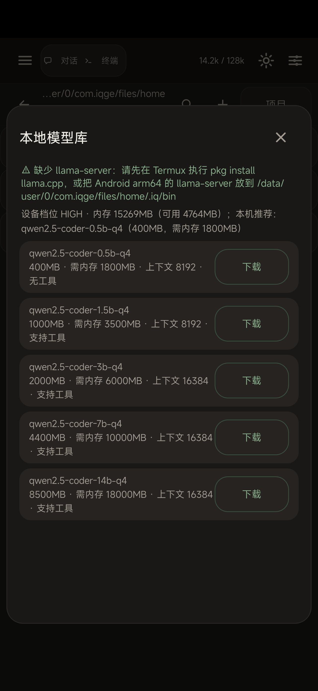

# 元境 · YuanJing

> 装在手机里的 AI 智能体 —— 能对话、会动手执行终端命令、断网也能靠本地小模型继续干活。
> 原名 IQ Code，已全面品牌化为 **元境**。


---

## 截图

**本地模型库（真机实拍）** —— 自动体检手机档位与可用内存，按档位推荐模型并打「推荐」标签：



## 这是什么

元境把「AI 对话 + 终端命令 + 工具调用」合成一个闭环：你打字提需求 → 大模型思考 → 自动执行命令/读写文件 → 结果再喂回模型，形成「思考 → 执行 → 再思考」的智能体循环。

**四大能力**：

| 能力 | 说明 |
|---|---|
| AI 智能体对话 | 多模型、流式输出，像聊天一样指挥它干活 |
| 终端 + 工具执行 | 内置 Termux Linux 终端；高风险命令过权限门，你确认才执行 |
| 本地小模型离线兜底 | 自动体检设备（档位 + 可用内存），按档位推荐可跑的模型；断网/云端失败自动切本地 |
| 一键检查更新 | 关于页点「检查更新」，连 GitHub Release 查最新版，有新版本弹窗给下载页 |

## 快速开始

**直接下载安装包**：到 [Releases](https://github.com/zihan8023/yuanjing/releases) 下载最新 APK（Android 8+ / arm64-v8a），首次安装需允许「安装未知来源应用」。

**从源码构建**：

```bash
# 需要 JDK 17、Android SDK（compileSdk 见根 build.gradle）
./gradlew --no-daemon assembleDebug
# 产物：app/build/outputs/apk/debug/元境-debug.apk
```

> 注意：`local.properties`、`*.jks` 签名文件已被 .gitignore 排除，不入库；本仓库 Release 使用项目内测试签名，正式分发请更换为自己的签名。

## 本地模型（离线兜底）

- 入口：设置 → 本地模型库。
- **设备体检**：自动读取 CPU 核数、总内存/可用内存、温度，得出设备档位 LOW / MID / HIGH。
- **推荐标签**：按「需内存 ≤ 可用内存 × 0.7」判定：

| 标签 | 颜色 | 含义 |
|---|---|---|
| 推荐 | 天蓝 | 最适合当前手机，流畅跑 |
| 可运行 | 绿 | 能跑但偏大，谨慎 |
| 内存不足 | 红 | 别下载，会卡死 |

- 模型档位：qwen2.5-coder 0.5b / 1.5b / 3b / 7b / 14b（3b 起支持工具调用），下载支持断点续传。
- 运行时依赖：`llama-server`。Termux 执行 `pkg install llama.cpp`，或把 arm64 二进制放到 `~/.iq/bin`。

## 更新机制（重要）

元境**通过 GitHub Releases 检查更新**，流程如下：

1. 开发者发布新版：给仓库打 tag（如 `v0.31.0`）+ Release，把 APK 作为 Release 资产上传。
2. 用户端：**关于页 → 「检查更新」**（手动触发，不自动下载安装）。
3. App 请求 `https://api.github.com/repos/zihan8023/yuanjing/releases/latest`：
   - 有新版本 → 弹窗「发现新版本 vX.X.X」+「打开下载页」按钮（跳转 GitHub Release 页面下载 APK）。
   - 无新版本 → 提示「已是最新」。
   - 从未发布过 → 提示「开发者尚未发布 Release」。

**当前是"手动检查 + 跳转下载页"模式**（自动静默安装需要系统权限，Android 限制普通 App 无法自动安装；后续可加"启动时自动检查一次 + 角标提醒"，见 docs 审计清单 P2）。

版本号比较逻辑：`compareVersions()` 逐段对比 `tag_name`，仅当新版本号大于当前 `versionName` 才提示。

## 文档索引

| 文档 | 说明 |
|---|---|
| [开发文档汇总](docs/开发文档汇总.md) | 架构、品牌改造清单、本地模型系统、构建方法 |
| [审计与下阶段优化清单](docs/审计与下阶段优化清单.md) | P0 安全项 / P1 体验项 / P2 增强项 / 发版 checklist |
| [消费者使用指南](docs/消费者使用指南.md) | 小白版使用说明，逐界面讲解 |

## 项目结构

```
app/                   # 主工程（UI + 智能体集成）
  src/main/java/com/iqge/           # UI 与系统集成（MainActivity 等）
  src/main/java/com/termux/app/iqcode/  # Agent 引擎 + 本地模型（DeviceProfile / LocalModelManager / RouterProvider）
  src/main/res/                      # 资源（元境品牌图标、主题）
Bcore/                 # 核心库
black-reflection/      # 反射辅助
compiler/              # 编译期辅助
docs/                  # 文档与截图
```

## 技术栈

- 纯 Java + 自绘 UI（无 XML 布局，主题令牌集中在 `applyUiPalette()`）
- `IQCodeEngine` 单线程主循环：消息排队 → 调模型 → 流式输出 → 工具成批执行 → 自动压缩上下文
- Shizuku（无 Root shell 权限）、Termux 兼容层、llama.cpp（本地推理）
- Release 构建开启 R8 混淆裁剪

## License

[MIT](LICENSE) © 2026 zihan8023
